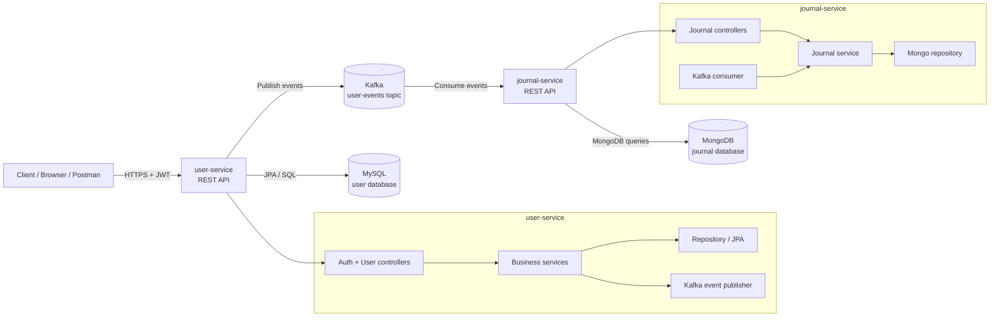

# Microservices Project

The project contains two Spring Boot services. `user-service` stores accounts in MySQL, issues JWTs, and publishes user-operation events to Kafka. `journal-service` validates those JWTs, consumes the events, stores journal records in MongoDB, and exposes a read-only journal API.

## Architecture and authentication

The application follows a small event-driven microservice design with a single source of truth for identity and a downstream read model for journaling.



### Service responsibilities

- `user-service` is the primary entry point for all user management and authentication. It exposes login, registration, profile, role-management, and admin endpoints.
- `journal-service` is a consumer-driven read model. It does not issue tokens, and it does not own user credentials. It validates JWTs and stores audit/journal records coming from Kafka.
- `Kafka` is the integration layer between the two services. When a user operation is created or modified, `user-service` publishes an event and `journal-service` consumes it to maintain a mirrored journal record set.
- MySQL holds the canonical user account state; MongoDB stores the operational journal used by the journaling API.

### Authentication model

There is no API gateway. `user-service` is the only token issuer. Tokens use HS512 and include the user ID in `sub`, plus `email`, `roles`, `iss`, `iat`, `exp`, and `jti`. Both services validate the signature and issuer using the same `JWT_SECRET`. The secret must contain at least 64 bytes.

Authentication flow:

1. A client sends credentials to `POST /api/auth/login` on `user-service`.
2. `user-service` verifies the password and creates a JWT signed with the shared secret.
3. The client includes the JWT in the `Authorization: Bearer <token>` header for protected requests.
4. `user-service` and `journal-service` both validate the token before allowing access to protected routes.
5. Role-based access is enforced using the `roles` claim, with `ADMIN` required for user administration and journal API access.

### User and role rules

- Public registration always creates a `USER`.
- An `ADMIN` is created at `user-service` startup only when both `ADMIN_EMAIL` and `ADMIN_PASSWORD` are non-blank and no administrator exists.
- An administrator can also assign roles through `PUT /api/users/{id}`.
- Journal endpoints require an `ADMIN` token.
- Logout records a `LOGOUT` event but does not revoke the JWT. The token remains valid until its expiration time.
## Technology

| Component | Implementation |
|---|---|
| Java | 21 |
| Spring Boot | 3.2.2 |
| User database | MySQL 8.0, Spring Data JPA |
| Journal database | MongoDB 6, Spring Data MongoDB |
| Kafka | Confluent `cp-kafka:7.5.1`, KRaft mode |
| JWT | JJWT 0.11.5, HMAC-SHA512 |
| API documentation | Springdoc OpenAPI 2.2.0 |
| Tests | JUnit Jupiter, AssertJ, Mockito, Spring Boot Test |
| Coverage | JaCoCo |

## Requirements and setup

- Docker with the Docker Compose v2 plugin.
- JDK 21 or later for running the applications on the host. The Maven wrapper is included.

Copy `.env.example` to `.env` and fill in the required values. Never commit `.env`. Generate `JWT_SECRET` with `openssl rand -hex 32` on Linux/macOS/Git Bash or `[Convert]::ToHexString([Security.Cryptography.RandomNumberGenerator]::GetBytes(32))` in PowerShell 7. Both services must receive the same secret and issuer.

Spring imports the root `.env` when an application is started from its service directory. Compose also reads the root `.env`. Environment variables exported in the shell take precedence over values in the file.

| Variable | Required | Default | Purpose |
|---|---:|---|---|
| `MYSQL_ROOT_PASSWORD` | Yes | None | MySQL root credential. |
| `MYSQL_APP_PASSWORD` | Yes | None | MySQL `appuser` password; also the fallback for user-service `DB_PASSWORD`. |
| `MONGO_ROOT_PASSWORD` | Yes | None | MongoDB root credential. |
| `MONGO_APP_PASSWORD` | Yes | None | MongoDB `journalapp` password. Use URI-safe characters such as hexadecimal. |
| `JWT_SECRET` | Yes | None | Shared HS512 signing/validation key, at least 64 bytes. |
| `JWT_ISSUER` | No | `user-service` | Issuer expected by both services. |
| `ADMIN_EMAIL` | No | `admin@example.com` in Compose; empty for a host run | Bootstrap administrator email for user-service. |
| `ADMIN_PASSWORD` | Yes in Compose | Empty for a host run | Bootstrap administrator password for user-service. |
| `IMAGE_TAG` | No | `latest` | Tag used by the base Compose file. |
| `USER_DDL_AUTO` | No | `update` | JPA schema mode in Compose. |
| `SWAGGER_ENABLED` | No | `false` | Enables OpenAPI and Swagger UI. Set to `true` for host runs when needed. |
| `KAFKA_CLUSTER_ID` | No | `MkU3OEVBNTcwNTJENDM2Qk` | KRaft cluster ID. |

Other useful host-run settings are `DB_URL`, `DB_USERNAME`, `DB_PASSWORD`, `DB_URI`, `KAFKA_BOOTSTRAP_SERVERS`, `GROUP_ID`, `TOPIC_USER_CREATED`, and `TOPIC_USER_FAILED`. Application defaults are in each service's `application.properties`. Compose supplies its container-specific database URLs and Kafka addresses.

MongoDB's `mongo-init/01-create-user.js` script creates the `journalapp` account only when the MongoDB data volume is initialized for the first time. If credentials change after initialization, the existing database user must be updated separately or the data volume must be deliberately recreated.

## Running the project

Run commands from the repository root. Windows users should use PowerShell and the `.cmd` Maven wrapper.

### Development mode

Databases and Kafka run in Docker; the Spring services run on the host with restart-on-change development support.

```bash
docker compose stop user-service journal-service
docker compose -f docker-compose.yml -f docker-compose.local.yml up -d kafka kafka-init mysql-user mongodb-journal
```

In separate terminals:

```bash
cd user-service && ./mvnw spring-boot:run
```

```bash
cd journal-service && ./mvnw spring-boot:run
```

On Windows, run `.\mvnw.cmd spring-boot:run` from each service directory.

If Spring does not import `.env`, load it into the shell first. Linux/macOS:

```bash
set -a
. ./.env
set +a
```

PowerShell:

```powershell
Get-Content .env | Where-Object { $_ -match '^\s*[^#\s].*=' } | ForEach-Object { $k,$v = $_ -split '=',2; [Environment]::SetEnvironmentVariable($k.Trim(),$v.Trim()) }
```

For host-run applications only, set `SWAGGER_ENABLED=true` in `.env` to enable Swagger.

### Local Docker build

This builds both application images from source and runs the full stack:

```bash
docker compose down
docker compose -f docker-compose.yml -f docker-compose.local.yml up --build -d
```

### Docker Hub images

The base Compose file uses the published `sahilsheikhdev/user-service` and `sahilsheikhdev/journal-service` images:

```bash
docker compose down
docker compose pull
docker compose up -d
```

`IMAGE_TAG` selects the image version. Only one run mode can be active at a time because the modes share container names and host ports.

### Everyday commands

| Task | Command |
|---|---|
| Status | `docker compose ps` |
| Logs | `docker compose logs -f --tail 100` |
| Stop and keep data | `docker compose down` |
| Delete all Compose data | `docker compose down -v` |
| Health | `curl http://localhost:8081/actuator/health` (PowerShell: `curl.exe`) |

The local overlay publishes Kafka on `localhost:29092`, MySQL on `127.0.0.1:3307`, and MongoDB on `127.0.0.1:27018`. The base Compose file does not publish those infrastructure ports.

Kafka topic auto-creation is disabled. The one-shot `kafka-init` service creates `user-events` with three partitions and `user-operation-failed` with one partition before either application starts. To run the end-to-end checks against a healthy stack, use `bash scripts/smoke.sh` from the repository root; the script requires `jq` and `curl`.

## API

Both services return JSON errors with this shape:

```json
{
  "timestamp": "2025-01-01T00:00:00Z",
  "status": 400,
  "error": "Bad Request",
  "code": "VALIDATION_ERROR",
  "message": "Request validation failed",
  "path": "/api/users",
  "fieldErrors": [
    { "field": "email", "message": "must be a well-formed email address" }
  ]
}
```

`fieldErrors` is an array and is empty when there are no field-level validation errors. 5xx responses use a generic message; exception details are logged rather than returned.

All list endpoints accept `page` (default `0`), `size` (default `20`, maximum `100`), and `sort`. Responses use `{content,page,size,totalElements,totalPages}`.

### user-service

Base URL: `http://localhost:8081`

| Method | Path | Access | Behavior |
|---|---|---|---|
| `GET` | `/` | Public | Service status. |
| `GET` | `/actuator/health` | Public | Health status. |
| `POST` | `/api/auth/login` | Public | Authenticates credentials and returns `accessToken`, `tokenType`, and `expiresIn` in seconds. |
| `POST` | `/api/auth/logout` | Authenticated | Records logout; the token is not revoked. |
| `POST` | `/api/users` | Public | Registers a `USER`; response is `201`. `name`, `email`, and `password` are required. Registration ignores any `roles` property in the body. |
| `GET` | `/api/users` | `ADMIN` | Paginated user list. |
| `GET` | `/api/users/me` | Authenticated | Returns the current account. |
| `GET` | `/api/users/{id}` | `ADMIN` or that user | Returns one account. |
| `PUT` | `/api/users/{id}` | `ADMIN` | Updates account fields; all fields are optional, and supplied roles must be `USER` or `ADMIN`. |
| `DELETE` | `/api/users/{id}` | `ADMIN` | Deletes the account. |

User responses contain `id`, `name`, `email`, `roles`, `createdAt`, and `updatedAt`; they never contain passwords.

### journal-service

Base URL: `http://localhost:8082`

| Method | Path | Access | Behavior |
|---|---|---|---|
| `GET` | `/` | Public | Service status. |
| `GET` | `/actuator/health` | Public | Health status. |
| `GET` | `/api/journals` | `ADMIN` | Paginated journal list; default sort is `operationTime,desc`. |
| `GET` | `/api/journals/user/{userId}` | `ADMIN` | Paginated events for a numeric user ID. |
| `GET` | `/api/journals/{id}` | `ADMIN` | Returns one journal entry. |
| `DELETE` | `/api/journals/{id}` | `ADMIN` | Deletes one journal entry; response is `204`. |

Journal entries are created only by the Kafka consumer. There are no journal create or update endpoints. Journal JSON dates are ISO-8601 strings.

OpenAPI and Swagger UI endpoints are permitted by security but disabled by default. Set `SWAGGER_ENABLED=true` to enable them.

## Kafka event contract

`user-service` publishes events to `user-events` by default; `TOPIC_USER_CREATED` configures the topic for both services. The JSON contract is version 2:

```json
{
  "schemaVersion": 2,
  "eventId": "a2d5a649-5ca8-4ea6-9aa4-9555ca343020",
  "occurredAt": "2025-01-01T00:00:00Z",
  "operation": "CREATE",
  "status": "SUCCESS",
  "comment": "User created",
  "userId": 1,
  "userName": "Example User",
  "userEmail": "user@example.com",
  "userRole": "USER"
}
```

Operations are `CREATE`, `UPDATE`, `DELETE`, `LOGIN`, and `LOGOUT`; statuses are `SUCCESS` and `FAILURE`. The Kafka key is the user ID as a string, or `unknown` when the ID is absent. Events never serialize entities or include passwords. Reading users does not publish events. A failed login event contains only the attempted email, a null user ID, and the comment `Invalid credentials`.

The producer sends events asynchronously after a successful transaction commit where applicable. Send failures are logged with the event ID and topic. There is no outbox, so a process failure can lose an event. `journal-service` accepts the legacy nested-user event shape while existing topic data drains. Invalid messages are retried and then sent to `user-operation-failed` by default; configure the dead-letter topic with `TOPIC_USER_FAILED`. Duplicate v2 event IDs are skipped.

## Security and known limitations

- JWTs use a shared HS512 secret. Both services must use the same secret and `JWT_ISSUER`; a secret shorter than 64 bytes prevents startup.
- The login rate limiter is in-memory and per service instance; it is not shared across replicas and resets on restart.
- Logout is an audit event only. Existing tokens remain usable until expiry.
- Kafka delivery is not guaranteed without an outbox.
- HTTP and Kafka use plaintext in the provided Compose configuration; deploy behind appropriately secured network boundaries.

## Testing and coverage

Run unit tests without Docker:

```bash
cd user-service && ./mvnw -B test
cd journal-service && ./mvnw -B test
```

On Windows use `.\mvnw.cmd -B test`. `verify` runs unit tests, any `*IT.java` tests registered with Maven Failsafe, and the JaCoCo report/check:

```bash
cd user-service && ./mvnw -B verify
cd journal-service && ./mvnw -B verify
```

Docker is required for the Failsafe `*IT.java` integration tests. Both services use the shared image tags in `test-fixtures/testcontainers.properties`, matching `docker-compose.yml`. Test forks clear `SPRING_CONFIG_IMPORT` so Maven verification does not load the repository's `.env`. JaCoCo reports are written to `target/site/jacoco/index.html`.

Measured line coverage after excluding DTO, entity, modal, config, and application classes is 93.33% for user-service and 87.88% for journal-service. The verified JaCoCo minimums are 92% and 86%, respectively. The latest run passed 53 user-service unit tests and 5 integration tests, plus 37 journal-service unit tests and 4 integration tests.

## Troubleshooting

| Symptom | Check |
|---|---|
| Compose reports a missing variable | Fill the root `.env`, especially database credentials, `JWT_SECRET`, and `ADMIN_PASSWORD`. |
| A service cannot connect to a database | Check the service's database health, Compose network URL, and credentials. Initialization scripts run only on a fresh data volume. |
| MongoDB authentication fails | Check `MONGO_APP_PASSWORD`, the `authSource=journaldb` URI, and URI-safe password characters. |
| Kafka clients cannot connect | Host-run services use `localhost:29092`; containers use `kafka:9092`. Both services must share the same broker and topic. |
| Maven wrapper cannot run on Linux/macOS | Ensure the wrapper executable bit is present; if needed, restore it with `git update-index --chmod=+x user-service/mvnw journal-service/mvnw`. |
| Application startup rejects `JWT_SECRET` | Use a secret of at least 64 bytes and configure the same value in both services. |

## Publishing

The base Compose file pulls prebuilt images. Publishing and release automation are not included in this repository; publish new service images through the project's release process, then select their tag with `IMAGE_TAG`.
